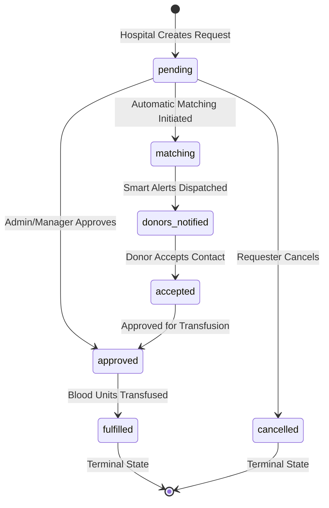

# BloodLink – Smart Blood Donor & Emergency Blood Request Management System

> **A Secure, Data-Driven Healthcare Web Platform Connecting Voluntary Blood Donors, Hospitals, and Blood Banks in Real Time.**  
> *Developed as an academic case study for the Master of Computer Applications (MCA) program.*

---

## 📋 Table of Contents

- [Project Overview](#-project-overview)
- [Problem Statement](#-problem-statement)
- [Project Objectives](#-project-objectives)
- [Key Features](#-key-features)
  - [1. User Registration and Authentication](#1-user-registration-and-authentication)
  - [2. Donor Registration and Profiles](#2-donor-registration-and-profiles)
  - [3. Blood Group and Location-Based Donor Search](#3-blood-group-and-location-based-donor-search)
  - [4. Smart Donor Matching Algorithm](#4-smart-donor-matching-algorithm)
  - [5. Emergency Blood Requests](#5-emergency-blood-requests)
  - [6. Donor Availability Management](#6-donor-availability-management)
  - [7. Automatic Donor Eligibility Management](#7-automatic-donor-eligibility-management)
  - [8. Smart Notification Priority System](#8-smart-notification-priority-system)
  - [9. Request Status Lifecycle Management](#9-request-status-lifecycle-management)
  - [10. Contact Request and Privacy Protection](#10-contact-request-and-privacy-protection)
  - [11. Blood Bank Inventory Management](#11-blood-bank-inventory-management)
  - [12. Admin Analytics Dashboard](#12-admin-analytics-dashboard)
- [Feature Implementation Matrix](#-feature-implementation-matrix)
- [Technology Stack](#-technology-stack)
- [System Modules](#-system-modules)
- [User Roles and Responsibilities](#-user-roles-and-responsibilities)
- [System Requirements](#-system-requirements)
- [Installation and Setup Instructions for Windows](#-installation-and-setup-instructions-for-windows)
- [Database Setup and Seeding](#-database-setup-and-seeding)
- [Testing Instructions](#-testing-instructions)
- [Project Folder Structure](#-project-folder-structure)
- [Security and Privacy Considerations](#-security-and-privacy-considerations)
- [Future Enhancements](#-future-enhancements)
- [Screenshots](#-screenshots)
- [Author](#-author)
- [License](#-license)

---

## 🩸 Project Overview

**BloodLink** is an enterprise-grade, MVC-architected web application built on **CodeIgniter 4** and **PHP 8.2+**. The platform addresses critical challenges in medical emergency blood logistics by providing an intelligent, centralized bridge between voluntary donors, healthcare institutions, and regional blood bank facilities.

Unlike traditional static donor directories, BloodLink incorporates an automated **100-Point Smart Matching Algorithm**, dynamic **90-Day Medical Eligibility Calculations**, multi-state **Request Status Lifecycles**, priority-ranked **Emergency Alerts**, and a privacy-preserving **Contact Request Consent Protocol**.

> 🎓 **Academic Note:** This project was designed, architected, and tested as a locally developed practical software engineering project for an MCA program, demonstrating clean MVC architecture, service-oriented business logic, database migrations, security best practices, and automated unit testing.

---

## ❗ Problem Statement

During medical crises, surgical procedures, and emergency trauma situations, every second counts. Traditional blood donation management faces critical vulnerabilities:

1. **Information Asymmetry:** Hospitals and patients rely on fragmented phone trees or social media posts to find matching blood donors.
2. **Incompatible and Ineligible Donor Outreaches:** Requesters often contact donors who are medically ineligible (having donated less than 90 days ago) or biologically incompatible, losing valuable time.
3. **Donor Privacy Exposure:** Public directories expose donors' personal contact numbers to spam, unauthorized calls, and privacy breaches.
4. **Uncoordinated Inventory Tracking:** Blood bank facilities operate in silos, leading to stock-outs or expired blood units without real-time inventory alerts.
5. **Lack of Lifecycle Transparency:** Requesters and medical administrators have no real-time tracking of whether an emergency requirement has been matched, accepted, fulfilled, or cancelled.

BloodLink solves these pain points by integrating automated compatibility calculations, eligibility rule verification, inventory synchronization, and consent-based contact sharing into a single unified platform.

---

## 🎯 Project Objectives

- **Accelerate Emergency Response Time:** Rapidly match critical blood requests with active, verified, and geographically proximate donors.
- **Enforce Medical Safety and Biological Compatibility:** Automatically calculate ABO/Rh blood group compatibility and uphold medical donation rest intervals (90-day cooldown).
- **Protect Donor Privacy:** Guard sensitive donor phone numbers and emails behind an authenticated, voluntary two-way consent mechanism.
- **Maintain Real-Time Blood Bank Inventory:** Track blood unit stocks across facilities with automated alerts for low stock (< 5 units) and stock-outs.
- **Deliver Operational Visibility:** Equip healthcare administrators with a high-level analytics dashboard providing real-time data on blood demand, stock health, and regional shortages.
- **Maintain High Software Engineering Standards:** Implement clean separation of concerns (MVC + Service Layer), relational schema design with migrations, robust session-based role authorization, and comprehensive unit tests.

---

## ✨ Key Features

All features listed below are verified and implemented directly within the BloodLink codebase.

### 1. User Registration and Authentication
- **Multi-Role Registration:** Dedicated onboarding workflows for voluntary blood donors (`/register/donor`) and hospitals / healthcare organizations (`/register/hospital`).
- **Cryptographic Security:** Passwords are encrypted using PHP's native BCrypt hashing (`password_hash` with `PASSWORD_DEFAULT`).
- **Account State Verification:** Verifies account status (`active` vs. suspended) before granting system access.
- **Session Protection:** Session regeneration (`session()->regenerate()`) upon authentication prevents session fixation attacks.
- **Role-Based Dynamic Routing:** Automatic post-login redirection directs each user to their designated dashboard (`/donor/dashboard`, `/hospital/dashboard`, `/bloodbank/dashboard`, or `/admin/dashboard`).

### 2. Donor Registration and Profiles
- **Comprehensive Profile Capture:** Captures blood group, gender, date of birth, residential city, full address, last donation date, and baseline medical eligibility.
- **Relational Integrity:** Implements a normalized one-to-one relationship between the `users` credentials table and the `donor_profiles` clinical record table.
- **Self-Service Profile Management:** Donors can review and update their profile details and personal information at any time (`/donor/profile/edit`).

### 3. Blood Group and Location-Based Donor Search
- **Public Accessibility:** Allows patients and family members to search for donors without mandatory initial login (`/find-blood`).
- **Multi-Factor Filtering:** Search by recipient blood group and target city.
- **Dual Availability Overview:** Simultaneously presents compatible active donors and local blood bank facility stock matching the query.
- **Privacy Masking:** Unauthenticated or unauthorized visitors see protected donor contacts, requiring authenticated requests to unlock personal details.

### 4. Smart Donor Matching Algorithm
Implemented in `App\Services\BloodMatchingService`, this service ranks donors using a deterministic **100-Point Scoring Model**:

$$\text{Total Match Score} = S_{\text{blood}} + S_{\text{availability}} + S_{\text{eligibility}} + S_{\text{city}} + S_{\text{recency}}$$

| Scoring Factor | Max Points | Evaluation Logic |
| :--- | :---: | :--- |
| **Blood Compatibility** | **40 pts** | Exact blood group match = **40 pts**<br>Compatible non-exact match (e.g., O- for A+) = **25 pts**<br>Incompatible group = **0 pts** (disqualified) |
| **Donor Availability** | **20 pts** | Status `available` = **20 pts**<br>Status `temporarily_unavailable` / `not_available` = **0 pts** |
| **Medical Eligibility** | **15 pts** | Dynamic eligibility confirmed = **15 pts**<br>Ineligible / pending cooldown = **0 pts** |
| **Location Match** | **15 pts** | Case-insensitive city match = **15 pts**<br>Different city = **0 pts**<br>No city filter specified = **15 pts** |
| **Donation Recency** | **10 pts** | First-time donor or last donation $\ge$ 90 days ago = **10 pts**<br>Last donation 60–89 days ago = **5 pts**<br>Last donation < 60 days ago = **0 pts** |

#### Complete Biological ABO / Rh Compatibility Matrix Supported:
- **A+ Recipient:** Accepts A+, A-, O+, O-
- **A- Recipient:** Accepts A-, O-
- **B+ Recipient:** Accepts B+, B-, O+, O-
- **B- Recipient:** Accepts B-, O-
- **AB+ Recipient:** Universal recipient (Accepts A+, A-, B+, B-, AB+, AB-, O+, O-)
- **AB- Recipient:** Accepts AB-, A-, B-, O-
- **O+ Recipient:** Accepts O+, O-
- **O- Recipient:** Universal donor blood (Accepts O- only)

### 5. Emergency Blood Requests
- **Structured Emergency Intake:** Hospitals post urgent requirements specifying blood group, units needed, hospital name, address, city, urgency level, required date, and medical condition details (`/requests/create`).
- **Donor Role Restriction:** Donors are restricted from creating hospital requests; this capability is reserved for healthcare institutions, managers, and admins.
- **Date Validation:** Enforces strict validation preventing retroactive or past required dates.
- **Automated Dispatch:** Instantly alerts administrators, managers, and compatible nearby donors with prioritized emergency notifications.

### 6. Donor Availability Management
- **Donor Agency:** Donors control their real-time readiness through a single toggle in their dashboard (`/donor/availability/update`).
- **Three Core Availability States:**
  1. `available`: Ready for emergency matching and notifications.
  2. `temporarily_unavailable`: Paused due to short-term reasons (travel, mild illness, temporary fatigue).
  3. `not_available`: Excluded from matching and notifications.
- **Strict Authorization:** Enforces server-side checks verifying that donors can only update their own profile availability.

### 7. Automatic Donor Eligibility Management
Implemented in `App\Services\DonorEligibilityService`, the platform calculates clinical donation eligibility without manual intervention:
- **90-Day Standard Donation Interval:** Enforces `MIN_DONATION_INTERVAL_DAYS = 90` based on healthcare blood donation guidelines.
- **Rule Verification Engine:**
  - Active user + no previous donation record = **ELIGIBLE** (first-time donor).
  - Last donation date $\ge$ 90 days ago = **ELIGIBLE**.
  - Last donation date < 90 days ago = **NOT ELIGIBLE** (computes elapsed days and remaining cooldown days).
  - Future donation dates = **NOT ELIGIBLE** (flagged as invalid).
  - Inactive user accounts = **NOT ELIGIBLE**.

### 8. Smart Notification Priority System
- **Urgency-to-Priority Mapping:**
  - `critical` urgency $\rightarrow$ `critical` priority (`🚨 CRITICAL BLOOD REQUEST`)
  - `urgent` / `high` urgency $\rightarrow$ `high` priority (`⚠️ HIGH PRIORITY BLOOD REQUEST`)
  - `normal` / `medium` urgency $\rightarrow$ `normal` priority (`🩸 BLOOD REQUEST`)
  - `low` urgency $\rightarrow$ `low` priority (`🩸 LOW PRIORITY BLOOD REQUEST`)
- **Priority-First Retrieval:** Uses SQL `FIELD(priority, 'critical', 'high', 'urgent', 'normal', 'low')` so critical alerts always appear at the top.
- **Duplicate Prevention:** Checks `(user_id, request_id)` pairings to avoid spamming donors with duplicate notifications for the same emergency.
- **Read Receipt Tracking:** Tracks unread counts (`is_read = 0`) with support for single-click and batch "Mark all as read" actions (`/notifications/mark-all-read`).

### 9. Request Status Lifecycle Management
Blood requests follow an 8-state finite state machine with role-based transition validation:



- **Terminal State Protection:** Terminal states (`fulfilled`, `completed`, `cancelled`) cannot be modified by standard users; only administrators can override.
- **Automatic Inventory Synchronization:** Transitioning a request to `fulfilled` or `completed` automatically deducts matching units from inventory. Cancelling a previously fulfilled request automatically restores stock.

### 10. Contact Request and Privacy Protection
- **Consent-First Architecture:** Donors' personal telephone numbers and email addresses are never exposed to the public internet.
- **Two-Way Consent Flow:** Requesters submit a Contact Request (`/contact-requests`). The donor receives a notification, reviews the requester's details, and can **Accept** or **Decline**.
- **Contact Reveal:** Contact details are disclosed only after explicit donor acceptance.
- **Duplicate Prevention:** Prevents duplicate active contact requests from the same requester to the same donor for a given emergency requirement.

### 11. Blood Bank Inventory Management
- **Real-Time Stock Directory:** Tracks blood units across facilities categorized by blood group, blood bank name, city, units available, and expiry date (`/inventory`).
- **Dynamic Stock Health Thresholds:**
  - $\ge$ 5 units: **Available** (Green Badge)
  - 1 – 4 units: **Low Stock** (Warning Badge)
  - 0 units: **Out of Stock** (Danger Badge)
- **Automated Stock Alerts:** Dispatches high-priority notifications to Blood Bank Managers and Admins when stock drops below 5 units or hits 0.
- **Complete Audit Trail (`inventory_logs`):** Every addition, manual update, emergency deduction, and restoration is recorded with previous units, unit delta, new units, user ID, and timestamp.
- **Negative Stock Prevention:** Server-side validation prevents inventory adjustments that would result in negative stock balances.

### 12. Admin Analytics Dashboard
A data-driven operations dashboard (`/admin/dashboard`) backed by `App\Services\AnalyticsService`:
- **10 Core Operational KPIs:** Total Donors, Active Donors, Available Donors, Eligible Donors, Total Requests, Pending Requests, Approved Requests, Fulfilled Requests, Critical Requests, Urgent Requests.
- **User Role Distributions:** Counts of registered donors, hospitals, and blood bank managers.
- **Blood-Group-Wise Donor Analytics:** Registered, available, and eligible counts for each of the 8 blood groups.
- **Blood-Group-Wise Request Analytics:** Total, pending, approved, fulfilled, and cancelled requests per blood group.
- **Geographic Demand Breakdown:** Top cities and locations ranked by blood request volume.
- **Urgency Distribution Analysis:** Breakdown of requests by Critical, Urgent, and Normal urgency levels.
- **Facility Inventory Health:** Summary of total units across facilities, low-stock counts, and out-of-stock facilities.
- **Cross-Entity Audit Feed:** Recent activity across users, requests, donations, and system notifications.
- **Dynamic Multi-Dimensional Filters:** Filter dashboard metrics simultaneously by date range (`start_date`, `end_date`), blood group, and city.
- **Interactive Visualizations:** Chart.js integration displaying visual charts for demand by blood group, city demand, request status distribution, and urgency levels.

---

## 📊 Feature Implementation Matrix

| Module / Feature | Implemented File(s) | Verified Status |
| :--- | :--- | :---: |
| **Authentication & Role Redirection** | `app/Controllers/Auth.php`<br>`app/Models/UserModel.php` | ✅ Fully Verified |
| **Role & Auth Route Filters** | `app/Filters/AuthFilter.php`<br>`app/Filters/RoleFilter.php` | ✅ Fully Verified |
| **Donor Profiles & Availability Toggle** | `app/Controllers/Donor.php`<br>`app/Models/DonorModel.php` | ✅ Fully Verified |
| **Smart Donor Matching (100 Pts)** | `app/Services/BloodMatchingService.php` | ✅ Fully Verified |
| **Automatic 90-Day Donor Eligibility** | `app/Services/DonorEligibilityService.php` | ✅ Fully Verified |
| **Public Blood & Donor Search** | `app/Controllers/BloodRequest.php`<br>`app/Views/blood_requests/search.php` | ✅ Fully Verified |
| **Emergency Blood Request Creation** | `app/Controllers/BloodRequest.php`<br>`app/Models/BloodRequestModel.php` | ✅ Fully Verified |
| **Request Status Lifecycle & State Machine** | `app/Models/BloodRequestModel.php`<br>`app/Controllers/BloodRequest.php` | ✅ Fully Verified |
| **Priority-Ranked Notifications** | `app/Models/NotificationModel.php`<br>`app/Controllers/Notification.php` | ✅ Fully Verified |
| **Contact Request Consent & Privacy** | `app/Controllers/ContactRequest.php`<br>`app/Models/ContactRequestModel.php` | ✅ Fully Verified |
| **Blood Bank Inventory & Stock Alerts** | `app/Controllers/Inventory.php`<br>`app/Models/BloodInventoryModel.php` | ✅ Fully Verified |
| **Inventory Transaction Audit Logs** | `app/Models/InventoryLogModel.php` | ✅ Fully Verified |
| **Donation Records Management** | `app/Controllers/Donation.php`<br>`app/Models/DonationModel.php` | ✅ Fully Verified |
| **Admin Operations & Analytics Dashboard** | `app/Controllers/Admin.php`<br>`app/Services/AnalyticsService.php` | ✅ Fully Verified |
| **Automated Unit Test Suites** | `tests/unit/*.php` (9 comprehensive test files) | ✅ Fully Verified |

---

## 💻 Technology Stack

### Backend
- **Framework:** CodeIgniter 4 (v4.7+)
- **Language:** PHP 8.2+ (strict types, `match` expressions, typed properties, constructor property promotion)
- **Architecture Pattern:** Model-View-Controller (MVC) supplemented with a Service Layer (`App\Services`)

### Database
- **Database Engine:** MySQL 5.7+ / MySQL 8.0+ or MariaDB 10.3+
- **Database Driver:** `MySQLi` / `pdo_mysql`
- **Schema Management:** CodeIgniter 4 Database Migrations & Seeders
- **Data Integrity:** Foreign key constraints, indexed lookup columns, transaction management (`transStart`, `transComplete`)

### Frontend
- **Markup:** Semantic HTML5
- **Styling Architecture:** **Custom Vanilla CSS Design System** (`public/assets/css/style.css`)
  - CSS Custom Properties / Design Tokens (modern color palette, elevation shadows, radii, transitions)
  - Responsive Grid and Flexbox layouts
  - Glassmorphic card accents, custom alert banners, badges, responsive navigation bar, and accessible modal overlays
  - *Note on Bootstrap:* Bootstrap is **NOT** used in this project. The application utilizes an entirely custom Vanilla CSS design system to ensure zero unnecessary bloat and maximum layout control.
- **Typography:** Google Fonts ([Inter](https://fonts.google.com/specimen/Inter))
- **Icons:** Inline vector SVGs
- **Data Visualization:** [Chart.js](https://www.chartjs.org/) (for Admin Dashboard visual graphs)
- **Client Scripting:** Lightweight Vanilla JavaScript (DOM manipulation, mobile menu drawer toggle, modal triggers)

### Testing & Tooling
- **Unit Testing:** PHPUnit 10.5+ (`CodeIgniter\Test\CIUnitTestCase`)
- **Dependency Management:** Composer 2.x
- **Development CLI:** CodeIgniter Spark CLI tool

---

## 🏛️ System Modules

```
┌────────────────────────────────────────────────────────────────────────┐
│                        BloodLink Architecture                          │
└────────────────────────────────────────────────────────────────────────┘
                                    │
    ┌───────────────────────────────┼───────────────────────────────┐
    ▼                               ▼                               ▼
┌─────────────────────┐   ┌─────────────────────┐   ┌─────────────────────┐
│ 1. Auth & Security  │   │ 2. Donor Management │   │ 3. Matching Engine  │
│  - Registration     │   │  - Profiles         │   │  - 100-pt Score     │
│  - BCrypt Auth      │   │  - Availability     │   │  - ABO Compatibility│
│  - Role Filters     │   │  - History          │   │  - 90-Day Cooldown  │
└─────────────────────┘   └─────────────────────┘   └─────────────────────┘
    │                               │                               │
    ├───────────────────────────────┼───────────────────────────────┤
    ▼                               ▼                               ▼
┌─────────────────────┐   ┌─────────────────────┐   ┌─────────────────────┐
│ 4. Blood Requests   │   │ 5. Contact Privacy  │   │ 6. Inventory & Logs │
│  - Creation Wizard  │   │  - Masked Numbers   │   │  - Multi-bank Stock │
│  - 8-State Machine  │   │  - 2-Way Consent    │   │  - Low-stock Alerts │
│  - Auto Deduction   │   │  - Anti-Spam Logic  │   │  - Audit Logs       │
└─────────────────────┘   └─────────────────────┘   └─────────────────────┘
    │                               │                               │
    └───────────────────────────────┼───────────────────────────────┘
                                    ▼
                        ┌─────────────────────┐
                        │ 7. Notifications &  │
                        │    Admin Analytics  │
                        │  - Priority Queue   │
                        │  - 10 Summary KPIs  │
                        │  - Chart.js Metrics │
                        └─────────────────────┘
```

1. **Authentication & Access Control Module:** Governs user login, donor/hospital registration, session integrity, and route authorization via `AuthFilter` and `RoleFilter`.
2. **Donor Management Module:** Manages personal donor profiles, medical history, donation log entries, and real-time availability statuses.
3. **Smart Matching & Eligibility Engine:** Evaluates ABO/Rh blood compatibility, runs the 100-point ranking algorithm, and verifies 90-day donation intervals.
4. **Emergency Blood Request & Lifecycle Module:** Handles emergency blood request creation, validation, filtering, and the 8-state status progression.
5. **Contact Request & Privacy Module:** Shields donor phone numbers behind a voluntary consent workflow, preventing unsolicited calls.
6. **Blood Bank Inventory Management Module:** Monitors blood unit stock levels across blood bank facilities, logs all changes in `inventory_logs`, and warns of shortages.
7. **Smart Notification Dispatcher:** Categorizes emergency notifications by priority (`critical`, `high`, `normal`, `low`), avoids duplicates, and tracks read receipts.
8. **Admin Operations & Analytics Module:** Aggregates operational KPIs, tracks multi-city demand, and visualizes system trends through interactive Chart.js graphs.

---

## 👥 User Roles and Responsibilities

The system seeds four standard roles (`RolesSeeder`):

| Role ID | Role Name | Primary Responsibilities & Permissions |
| :---: | :--- | :--- |
| **1** | **Admin** | System administrator with full privileges. Manages user accounts, views cross-entity audit trails, accesses the **Admin Analytics Dashboard**, overrides request statuses, and monitors system-wide inventory and stock alerts. |
| **2** | **Donor** | Voluntary blood donor. Registers profile, manages personal donation history, toggles availability status (`available`, `temporarily_unavailable`, `not_available`), receives prioritized blood match alerts, and responds to incoming Contact Requests (`accept` / `decline`). *Restricted from creating hospital blood requests.* |
| **3** | **Hospital** | Healthcare facility or patient representative. Posts emergency blood requests, specifies required units and medical urgency, monitors the status lifecycle of active requests, searches matching donors, and initiates Contact Requests to donors. |
| **4** | **Blood Bank Manager** | Blood storage facility personnel. Tracks regional blood stock, creates and edits inventory units, receives low stock alerts, records completed donor blood donations, and facilitates request fulfillment. |

---

## ⚙️ System Requirements

### Hardware Requirements
- **Processor:** 1.6 GHz multi-core processor or higher
- **Memory (RAM):** Minimum 2 GB (4 GB recommended)
- **Disk Storage:** At least 500 MB free space for application files and database growth

### Software & Server Requirements
- **Operating System:** Windows 10 / 11 (64-bit) *(also runs on Linux / macOS)*
- **PHP Version:** PHP 8.2 or higher (Compatible with PHP 8.2, 8.3, 8.4, and 8.5)
- **Web Server:** CodeIgniter built-in development server (`php spark serve`) or Apache / Nginx (e.g., via XAMPP, Laragon, WampServer)
- **Database:** MySQL 5.7+ / 8.0+ or MariaDB 10.3+
- **Dependency Manager:** Composer 2.x
- **Web Browser:** Any modern web browser (Google Chrome, Mozilla Firefox, Microsoft Edge, Brave, Safari)

### Mandatory PHP Extensions (Windows `php.ini`)
Make sure the following extensions are enabled (uncommented) in your `php.ini` file:

```ini
extension=intl         ; REQUIRED for CodeIgniter 4 localization and Time services
extension=mbstring     ; REQUIRED for multibyte string processing
extension=mysqli       ; REQUIRED for MySQL database connectivity
extension=pdo_mysql    ; Optional/Recommended for PDO database connectivity
extension=curl         ; REQUIRED for HTTP request handling
extension=openssl      ; REQUIRED for secure token and session generation
```

> ⚠️ **Important for Windows Users:** The `intl` extension is required by CodeIgniter 4's `Time` class. If `extension=intl` is commented out in your `php.ini`, CodeIgniter will throw a `Class "Locale" not found` error. Ensure this line is active before running migrations or launching the development server.

---

## 🛠️ Installation and Setup Instructions for Windows

Follow these step-by-step instructions to set up and run BloodLink on a Windows environment using PowerShell or Command Prompt.

### Step 1: Clone the Repository
Open PowerShell or Command Prompt in your preferred project directory:

```bash
git clone https://github.com/krishnabaviskar124/BloodLink.git
cd BloodLink
```

### Step 2: Install Composer Dependencies
Install all required application and testing packages:

```bash
composer install
```

### Step 3: Configure the Environment (`.env`) File
The repository includes an `env` template file. Make a copy named `.env`:

```powershell
# Using PowerShell:
Copy-Item env .env

# Or using Windows Command Prompt (cmd):
copy env .env
```

Open `.env` in your text editor (such as VS Code or Notepad) and configure your environment settings:

```ini
#--------------------------------------------------------------------
# ENVIRONMENT
#--------------------------------------------------------------------
CI_ENVIRONMENT = development

#--------------------------------------------------------------------
# APP
#--------------------------------------------------------------------
app.baseURL = 'http://localhost:8080/'

#--------------------------------------------------------------------
# DATABASE
#--------------------------------------------------------------------
database.default.hostname = localhost
database.default.database = bloodlink
database.default.username = root
database.default.password = 
database.default.DBDriver = MySQLi
database.default.DBPrefix = 
database.default.port = 3306
```

> 🔒 **Security Notice:** Do not commit production passwords, encryption keys, or sensitive credentials to version control. The credentials above are defaults for local development.

### Step 4: Verify and Enable the PHP `intl` Extension
Verify that `intl` is active in your PHP CLI:

```powershell
php -m | findstr intl
```

If nothing is returned:
1. Locate your active `php.ini` file (`php --ini`).
2. Open `php.ini` in an editor.
3. Find `;extension=intl` and remove the leading semicolon:
   ```ini
   extension=intl
   ```
4. Save the file and verify again with `php -m | findstr intl`.

### Step 5: Create the MySQL Database
Ensure your MySQL service is running (via MySQL CLI, XAMPP, or Laragon), then create the database:

```sql
CREATE DATABASE bloodlink CHARACTER SET utf8mb4 COLLATE utf8mb4_unicode_ci;
```

Alternatively, run this from the command line:

```powershell
mysql -u root -e "CREATE DATABASE IF NOT EXISTS bloodlink CHARACTER SET utf8mb4 COLLATE utf8mb4_unicode_ci;"
```

### Step 6: Run Database Migrations
Execute all schema migrations in chronological order:

```bash
php spark migrate
```

*This creates all 10 core tables, foreign key constraints, indexes, and custom enum definitions.*

### Step 7: Seed Initial Reference Data
Populate standard user roles and the 8 official blood groups:

```bash
php spark db:seed DatabaseSeeder
```

*This seeds `RolesSeeder` (Admin, Donor, Hospital, Blood Bank Manager) and `BloodGroupsSeeder` (A+, A-, B+, B-, AB+, AB-, O+, O-).*

### Step 8: Start the Local Development Server
Launch CodeIgniter 4's built-in development server:

```bash
php spark serve
```

You should see output similar to:
```
CodeIgniter v4.7.x Development Server started on http://localhost:8080
Press Control-C to stop.
```

Open your browser and navigate to:
```
http://localhost:8080
```

---

## 🗄️ Database Setup and Seeding

### Relational Schema Overview

The database schema consists of 10 interconnected tables managed through CodeIgniter 4 migrations:

| Table Name | Description | Key Relationships |
| :--- | :--- | :--- |
| `roles` | System user roles | Referenced by `users.role_id` |
| `blood_groups` | 8 official blood types (A+, A-, etc.) | Referenced by `donor_profiles`, `blood_requests`, `blood_inventory`, `donations` |
| `users` | User credentials, contact info, city, status | References `roles.id` |
| `donor_profiles` | Clinical donor profile, eligibility, availability | References `users.id`, `blood_groups.id` |
| `blood_requests` | Emergency blood requests and hospital requirements | References `users.id` (requester), `blood_groups.id` |
| `blood_inventory` | Blood bank stock records by facility and city | References `blood_groups.id` |
| `inventory_logs` | Audit trail for all stock transactions | References `blood_inventory.id`, `users.id` |
| `donations` | Historical records of completed donations | References `users.id` (donor), `blood_groups.id` |
| `notifications` | Priority-based user alerts and notifications | References `users.id` (recipient), `users.id` (sender), `blood_requests.id` |
| `contact_requests` | Two-way donor contact consent requests | References `users.id` (requester), `users.id` (donor), `blood_requests.id` |

### Available Seeder Classes

- **`DatabaseSeeder`**: Master seeder that runs both seeders below in sequence:
  ```bash
  php spark db:seed DatabaseSeeder
  ```
- **`RolesSeeder`**: Inserts the 4 foundational system roles (`Admin`, `Donor`, `Hospital`, `Blood Bank Manager`). Duplicates are safely ignored.
- **`BloodGroupsSeeder`**: Inserts the 8 official blood groups (`A+`, `A-`, `B+`, `B-`, `AB+`, `AB-`, `O+`, `O-`).

---

## 🧪 Testing Instructions

The project includes unit test suites using **PHPUnit 10** to verify business logic, security permissions, matching algorithms, and state machines.

### Test Suite Structure

All test cases are located in `tests/unit/`:

- **`SmartDonorMatchingTest.php`**: Validates the 100-point matching score across biological compatibility, donor availability, medical eligibility, location matching, and donation recency.
- **`DonorEligibilityTest.php`**: Tests the 90-day minimum donation interval, first-time donor eligibility, future date handling, and inactive account handling.
- **`BloodRequestLifecycleTest.php`**: Validates the 8-state request lifecycle, verifying allowed forward transitions and blocking invalid transitions or modifications to terminal states.
- **`BloodBankInventoryTest.php`**: Tests stock additions, deductions, low-stock status calculation (< 5 units), negative stock prevention, and inventory adjustment logging.
- **`ContactRequestPrivacyTest.php`**: Verifies donor contact privacy rules, initial `pending` status, duplicate request prevention, and authorization enforcement.
- **`SmartNotificationTest.php`**: Tests priority mapping (`critical`, `high`, `normal`, `low`), duplicate alert prevention, priority ordering, and read receipt tracking.
- **`AdminAnalyticsTest.php`**: Tests role authorization for the Admin dashboard, verifying access for Administrators and blocking unauthorized roles.
- **`DonorDashboardTest.php`**: Tests donor profile retrieval, donation count calculations, availability updates, and dashboard rendering.
- **`HealthTest.php`**: Baseline framework smoke test verifying the testing environment is operational.

### Running Tests

#### Run All Unit Tests
From the project root:

```powershell
# Using the Windows vendor binary:
vendor\bin\phpunit

# Or using Composer script:
composer test
```

#### Run an Individual Test Suite
To test a specific service or feature:

```powershell
# Test the 100-Point Smart Donor Matching Algorithm:
vendor\bin\phpunit tests/unit/SmartDonorMatchingTest.php

# Test the 90-Day Medical Eligibility Service:
vendor\bin\phpunit tests/unit/DonorEligibilityTest.php

# Test the Request Status Lifecycle State Machine:
vendor\bin\phpunit tests/unit/BloodRequestLifecycleTest.php

# Test Blood Bank Inventory and Low-Stock Alert Logic:
vendor\bin\phpunit tests/unit/BloodBankInventoryTest.php

# Test Contact Request Privacy and Two-Way Consent:
vendor\bin\phpunit tests/unit/ContactRequestPrivacyTest.php

# Test Priority Notification Queuing:
vendor\bin\phpunit tests/unit/SmartNotificationTest.php

# Test Admin Analytics Dashboard Permissions and Aggregations:
vendor\bin\phpunit tests/unit/AdminAnalyticsTest.php
```

---

## 📁 Project Folder Structure

```
BloodLinkProject/
├── app/
│   ├── Config/                     # Framework configuration (Routes, Database, App, Filters, etc.)
│   │   └── Routes.php              # Application route definitions and role filters
│   ├── Controllers/                # Application HTTP Controllers
│   │   ├── Admin.php               # Admin operations & analytics dashboard controller
│   │   ├── Auth.php                # Authentication, donor & hospital registration
│   │   ├── BaseController.php      # Base controller
│   │   ├── BloodBank.php           # Blood bank manager dashboard controller
│   │   ├── BloodRequest.php        # Emergency requests & public search controller
│   │   ├── ContactRequest.php      # Two-way donor contact request & privacy controller
│   │   ├── Donation.php            # Blood donation records controller
│   │   ├── Donor.php               # Donor dashboard, profile, & availability toggle
│   │   ├── Home.php                # Landing page controller
│   │   ├── Hospital.php            # Hospital operations dashboard controller
│   │   ├── Inventory.php           # Blood inventory & stock management controller
│   │   └── Notification.php        # User notifications & read receipts controller
│   ├── Database/
│   │   ├── Migrations/             # 16 chronological database migrations
│   │   └── Seeds/                  # Database seeders (Roles, Blood Groups, DatabaseSeeder)
│   ├── Filters/                    # HTTP Route Filters
│   │   ├── AuthFilter.php          # Enforces logged-in session state
│   │   └── RoleFilter.php          # Enforces role-based permissions (Admin, Donor, etc.)
│   ├── Models/                     # Database Models with validation & active record logic
│   │   ├── BloodGroupModel.php     # Blood group reference model
│   │   ├── BloodInventoryModel.php # Inventory model with stock adjustment & threshold calculations
│   │   ├── BloodRequestModel.php   # Blood request model with lifecycle transition rules
│   │   ├── ContactRequestModel.php # Contact request model with privacy checks
│   │   ├── DonationModel.php       # Donation records model
│   │   ├── DonorModel.php          # Donor clinical profiles model
│   │   ├── InventoryLogModel.php   # Audit trail log model for inventory adjustments
│   │   ├── NotificationModel.php   # Notification model with priority ordering & deduplication
│   │   └── UserModel.php           # User account and role relationship model
│   ├── Services/                   # Reusable Business Logic & Algorithmic Services
│   │   ├── AnalyticsService.php    # Server-side SQL metric aggregation for Admin dashboard
│   │   ├── BloodMatchingService.php# 100-Point Smart Donor Matching & ABO compatibility service
│   │   └── DonorEligibilityService.php # 90-Day Medical Eligibility Rule Engine
│   └── Views/                      # Presentation layer templates
│       ├── admin/                  # Admin Analytics Dashboard views
│       ├── auth/                   # Login and registration views
│       ├── blood_requests/         # Request index, search, create, and detail views
│       ├── bloodbank/              # Blood bank manager dashboard views
│       ├── donations/              # Donation listing and recording views
│       ├── donor/                  # Donor dashboard, profile, and donation views
│       ├── hospital/               # Hospital dashboard views
│       ├── inventory/              # Inventory management, creation, and editing views
│       ├── notifications/          # Priority notification listing views
│       └── layout.php              # Master layout with responsive navbar, flash alerts, and footer
├── public/                         # Public web root
│   ├── assets/
│   │   └── css/
│   │       └── style.css           # Custom Vanilla CSS Design System & Component Library
│   ├── favicon.ico                 # Application favicon
│   ├── index.php                   # Front controller entry point
│   └── robots.txt                  # Search engine crawler instructions
├── tests/                          # Automated test directory
│   ├── unit/                       # 9 PHPUnit test suites covering all core features
│   └── README.md                   # Testing instructions
├── writable/                       # Cache, session, and log writeable storage
├── .env                            # Local environment configuration file (git-ignored)
├── composer.json                   # PHP package dependencies and autoload configuration
├── env                             # Environment template configuration file
├── LICENSE                         # MIT License file
├── phpunit.dist.xml                # Default PHPUnit test runner configuration
├── README.md                       # Comprehensive project documentation
└── spark                           # CodeIgniter 4 CLI spark command executable
```

---

## 🔒 Security and Privacy Considerations

The platform incorporates several security layers across its codebase:

1. **Password Hashing:** Passwords are never stored in plaintext. The system uses PHP's native BCrypt algorithm (`password_hash($pass, PASSWORD_DEFAULT)`), which automatically incorporates secure random salts and cost factors.
2. **Cross-Site Scripting (XSS) Prevention:** Dynamic view outputs are sanitized using CodeIgniter's `esc()` context-aware output encoder.
3. **SQL Injection Mitigation:** All database interactions use CodeIgniter's Query Builder and parameterized prepared statements, preventing SQL injection vulnerabilities.
4. **Role-Based Access Control (RBAC):** Routes are protected using `AuthFilter` and `RoleFilter`. Unauthorized access attempts are blocked and redirected to the user's role-specific dashboard with an alert.
5. **Donor Contact Privacy Protection:** Donor contact details (phone, email) are shielded on public pages. Requesters must submit an authenticated Contact Request, and donors must voluntarily approve it before contact details are revealed.
6. **Session Fixation Prevention:** The session identifier is regenerated on authentication (`session()->regenerate()`), and all session data is destroyed upon logout (`session()->destroy()`).
7. **Input Validation and CSRF Defense:** Incoming form submissions are validated against strict rules (type checking, string length limits, date formats, valid enum values, and positive unit counts) before processing.
8. **Sensitive File Separation:** The front controller (`index.php`) and static assets reside within the `public/` directory, while application source code, configuration files, and `.env` live above the web root, keeping them protected from direct web access.

---

## 🚀 Future Enhancements

The following roadmap items represent potential avenues for extending BloodLink into a production-scale healthcare network:

- [ ] **SMS & WhatsApp Gateway Integration:** Integrate APIs like Twilio or Gupshup to send instant SMS or WhatsApp notifications for `critical` priority blood matches.
- [ ] **Geographic Radius & Map Mapping:** Incorporate the Google Maps API or Leaflet.js with Haversine distance calculations to calculate driving distance and travel time between donors and hospitals.
- [ ] **Native Mobile Application:** Build cross-platform mobile apps (Flutter / React Native) for iOS and Android to support push notifications and background location updates.
- [ ] **Automated Cooldown Reminders:** Set up automated cron jobs to notify donors as soon as their 90-day cooldown period expires, encouraging repeat donations.
- [ ] **Digital Donor Cards with QR Verification:** Generate unique digital donor cards with encrypted QR codes for quick check-in and verification at regional blood donation camps.
- [ ] **Direct Hospital-to-Bank Transfer Requests:** Allow hospitals to submit inter-facility blood unit transfer requests directly to nearby blood banks through the system.

---

## 📸 Screenshots

*Below are UI walkthrough placeholders representing the core views of BloodLink. Replace these placeholders with your actual screenshots when preparing project presentations.*

### 1. Home Page & Public Smart Search
<!-- Screenshot Placeholder 1 -->
```
+------------------------------------------------------------------------------------+
|  [🩸 BloodLink]   Home   Find Donors   Notifications(2)   Krishna (Donor)   [Logout] |
|------------------------------------------------------------------------------------|
|   Find Compatible Blood Donors in Real-Time                                        |
|   Select Blood Group: [ A+  v ]   City: [ Dhule          ]   [ 🔍 Find Donors ]     |
|------------------------------------------------------------------------------------|
|  Compatible Donors Found:                                                          |
|  - Krishna Baviskar | A+ | Available | Eligible (Score: 100%) | [Request Contact]  |
|  - Rahul Patil      | O+ | Available | Eligible (Score: 85%)  | [Request Contact]  |
|                                                                                    |
|  Blood Bank Stock in Dhule:                                                        |
|  - City Civil Blood Bank | A+ | 14 Units Available (In Stock)                      |
+------------------------------------------------------------------------------------+
```
*(File path: `docs/screenshots/01_public_search.png`)*

---

### 2. Emergency Blood Request Details & Donor Matching
<!-- Screenshot Placeholder 2 -->
```
+------------------------------------------------------------------------------------+
|  EMERGENCY BLOOD REQUEST #104                                     [Status: PENDING]|
|------------------------------------------------------------------------------------|
|  Hospital: Civil Hospital Dhule                Required Date: Tomorrow             |
|  Blood Group Needed: B+                        Units Required: 3 Units             |
|  Urgency: CRITICAL 🚨                          Location: Dhule                     |
|------------------------------------------------------------------------------------|
|  ⚡ Ranked Compatible Donors (Smart Matching Score):                               |
|  Name              Match Score   Compatibility   Availability   Contact Action     |
|  --------------------------------------------------------------------------------  |
|  Anil Sharma          100%           Exact Match      Available    [Request Contact] |
|  Suresh Verma          85%        Compatible (O-)     Available    [Request Contact] |
+------------------------------------------------------------------------------------+
```
*(File path: `docs/screenshots/02_blood_request_detail.png`)*

---

### 3. Donor Dashboard & Real-Time Availability Management
<!-- Screenshot Placeholder 3 -->
```
+------------------------------------------------------------------------------------+
|  DONOR DASHBOARD                                                                   |
|  Welcome, Krishna Baviskar! (Blood Group: A+)                                      |
|------------------------------------------------------------------------------------|
|  Availability Status: (•) Available  ( ) Temporarily Paused  ( ) Not Available      |
|                       [ Update Status ]                                            |
|                                                                                    |
|  Medical Eligibility: [ ✅ ELIGIBLE - 104 days since last donation ]               |
|                                                                                    |
|  Incoming Contact Requests:                                                        |
|  - Civil Hospital (Urgent A+ needed) -> [ Accept Contact ] [ Decline ]             |
+------------------------------------------------------------------------------------+
```
*(File path: `docs/screenshots/03_donor_dashboard.png`)*

---

### 4. Blood Bank Inventory & Stock Audit Logs
<!-- Screenshot Placeholder 4 -->
```
+------------------------------------------------------------------------------------+
|  BLOOD INVENTORY & STOCK MANAGEMENT                             [+ Add New Stock]  |
|------------------------------------------------------------------------------------|
|  Blood Group    Facility Name        City      Units Available   Stock Status      |
|  --------------------------------------------------------------------------------  |
|  A+             Metro Blood Bank     Mumbai        18 Units      [ Available ]     |
|  O-             Central Red Cross    Pune           2 Units      [ Low Stock ⚠️ ]  |
|  AB-            City Blood Center    Nashik         0 Units      [ Out of Stock 🚨]|
|------------------------------------------------------------------------------------|
|  Recent Inventory Audit Trail:                                                     |
|  - [Deduction] 2 units of B+ deducted for Emergency Request #102 by Admin          |
|  - [Addition]  5 units of O+ added by Blood Bank Manager                           |
+------------------------------------------------------------------------------------+
```
*(File path: `docs/screenshots/04_blood_inventory.png`)*

---

### 5. Data-Driven Admin Analytics Dashboard
<!-- Screenshot Placeholder 5 -->
```
+------------------------------------------------------------------------------------+
|  ADMIN OPERATIONS & EXECUTIVE ANALYTICS                                            |
|  Date Filter: [2026-08-01] to [2026-08-31]   Blood Group: [All]   City: [All]      |
|------------------------------------------------------------------------------------|
|  [ 124 Total Donors ]   [ 82 Available ]   [ 45 Requests ]   [ 38 Fulfilled ]      |
|                                                                                    |
|  📊 Demand by Blood Group (Chart.js)    🏙️ Top Demand Cities                      |
|     A+  : [████████████] 35%               1. Mumbai (18 requests)                 |
|     B+  : [█████████]    25%               2. Pune   (12 requests)                 |
|     O+  : [████████]     20%               3. Dhule  (8 requests)                  |
|     O-  : [████]         10%               4. Nashik (7 requests)                  |
+------------------------------------------------------------------------------------+
```
*(File path: `docs/screenshots/05_admin_analytics.png`)*

---

### 6. Smart Priority Notification Center
<!-- Screenshot Placeholder 6 -->
```
+------------------------------------------------------------------------------------+
|  NOTIFICATION CENTER                                          [ Mark All as Read ] |
|------------------------------------------------------------------------------------|
|  [CRITICAL 🚨] CRITICAL BLOOD MATCH ALERT                              2 mins ago  |
|  Emergency match for B+ needed at Civil Hospital, Dhule (3 units needed).          |
|                                                                                    |
|  [HIGH ⚠️] NEW CONTACT REQUEST                                         1 hour ago  |
|  Requester 'City Hospital' sent you a contact request for Request #98.            |
|                                                                                    |
|  [NORMAL 🩸] STATUS UPDATE                                             Yesterday   |
|  Your contact request to Donor 'Rahul Patil' was accepted.                         |
+------------------------------------------------------------------------------------+
```
*(File path: `docs/screenshots/06_notifications.png`)*

---

## 👨‍💻 Author

**Krishna Baviskar**  
- **GitHub:** [@krishnabaviskar124](https://github.com/krishnabaviskar124)  
- **Role:** Full-Stack Developer & Software Architect  
- **Project:** Master of Computer Applications (MCA) Academic Project

---

## 📄 License

This project is licensed under the **MIT License** – see the [LICENSE](LICENSE) file for full details.

```text
The MIT License (MIT)

Permission is hereby granted, free of charge, to any person obtaining a copy
of this software and associated documentation files (the "Software"), to deal
in the Software without restriction, including without limitation the rights
to use, copy, modify, merge, publish, distribute, sublicense, and/or sell
copies of the Software, and to permit persons to whom the Software is
furnished to do so, subject to the following conditions:

The above copyright notice and this permission notice shall be included in
all copies or substantial portions of the Software.
```

---

<p align="center">
  <b>BloodLink – Every Drop Connects a Life.</b><br>
  <i>Built with CodeIgniter 4, PHP 8.2+, MySQL, and Vanilla CSS.</i>
</p>
